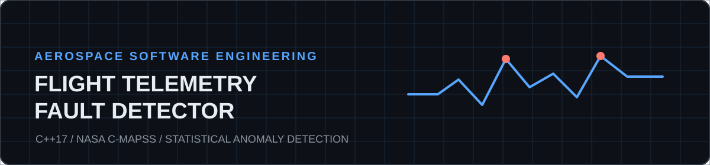
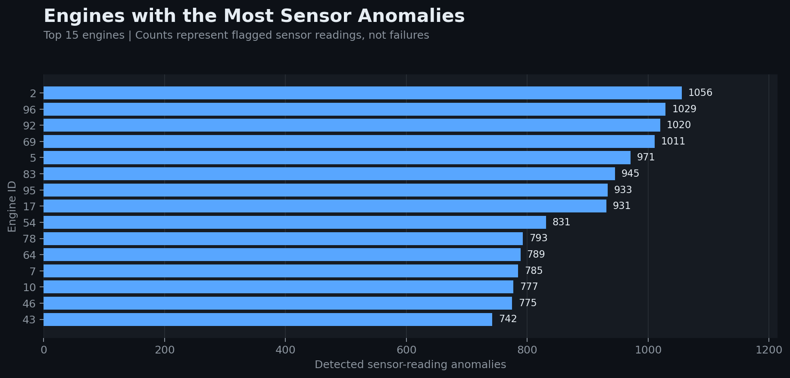
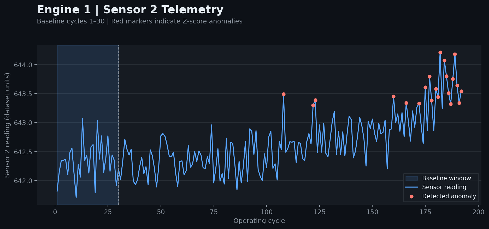
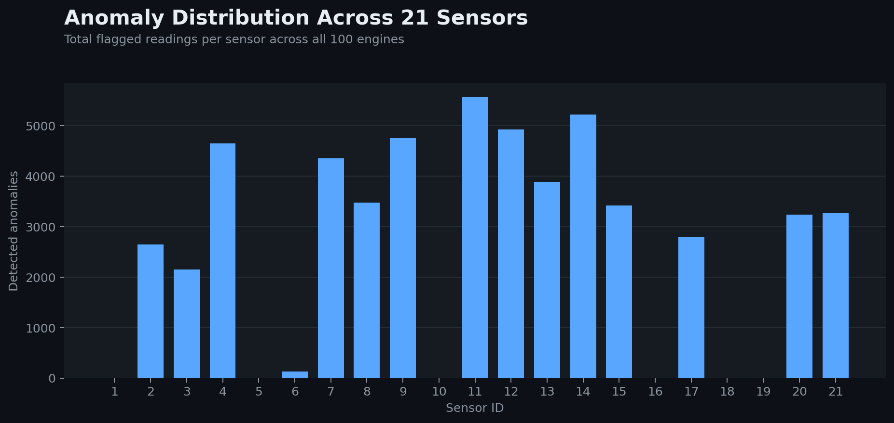
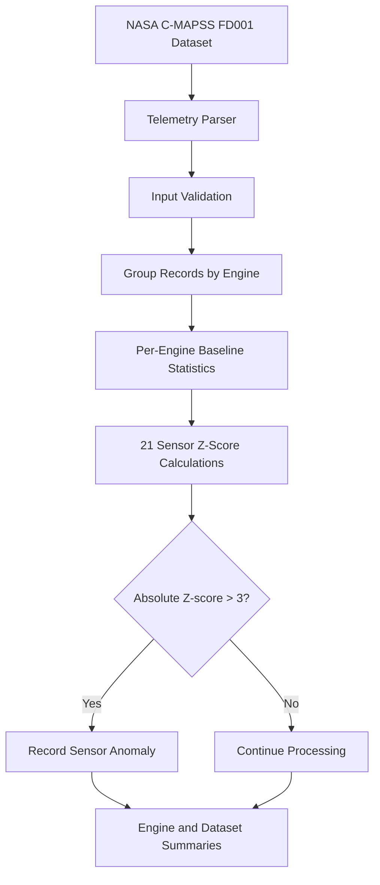

<div align="center">



# Flight Telemetry Fault Detector

**A modular C++17 anomaly detection system for simulated turbofan engine telemetry.**


[Overview](#overview) · [Results](#results) · [Architecture](#architecture) · [Quick Start](#quick-start) · [Testing](#testing)

</div>

---

## Overview

This project analyzes simulated aircraft turbofan engine telemetry to detect unusual sensor behavior. Built with **C++17**, it processes the NASA C-MAPSS FD001 training dataset, calculates independent baseline statistics for each engine, and flags sensor readings that deviate significantly from those baselines.

### At a glance

| 100 Engines | 20,631 Records | 21 Sensors | 54,481 Flags |
|:---:|:---:|:---:|:---:|
| Analyzed | Processed | Per engine | Sensor-reading anomalies |

> **Important:** Detected anomalies are statistical deviations, not confirmed mechanical failures. Multiple sensor anomalies may occur in the same engine cycle.

## Results

The detector uses the first 30 operating cycles of each engine as a reference window and flags subsequent readings when the absolute Z-score exceeds 3.0.

### Engines with the most detected anomalies



This chart compares flagged sensor-reading counts across the 15 engines with the highest counts. Counts should not be interpreted as engine failure rates.

### Sensor behavior over time



Engine 1, Sensor 2: the highlighted area represents the baseline window. Red points indicate readings flagged by the detector.

### Anomalies by sensor



This distribution shows which sensor channels contribute the most flagged readings across the dataset.

### Verified output

| Metric | Result |
|---|---:|
| Total telemetry records | 20,631 |
| Engines analyzed | 100 |
| Engines skipped | 0 |
| Baseline window | 30 cycles |
| Z-score threshold | 3.0 |
| Engine 1 anomalies | 502 |
| Total sensor-reading anomalies | **54,481** |
| Unit tests | **7 passed** |

## Architecture



### Detection methodology

For each engine and sensor, calculate the baseline mean and population standard deviation using cycles 1–30.

$$
z = \frac{x - \mu}{\sigma}
$$

Flag a reading when:

$$
|z| > 3.0
$$

Sensors with near-zero baseline standard deviation are skipped to avoid unstable division. This is a fixed-baseline statistical detector, not a trained machine-learning classifier.

## Project Structure

```text
flight-telemetry-fault-detector/
├── assets/
│   ├── banner.svg
│   ├── anomalies_by_engine.png
│   ├── engine1_sensor2.png
│   └── anomalies_by_sensor.png
├── src/
│   ├── main.cpp
│   ├── telemetry.cpp
│   └── telemetry.h
├── tests/
│   └── test_telemetry.cpp
├── data/
│   └── cmapss/
│       └── train_FD001.txt
├── .gitignore
└── README.md
```

## Quick Start

### Requirements

- C++17-compatible compiler (GCC or Clang)
- NASA C-MAPSS FD001 training data at `data/cmapss/train_FD001.txt`

### Build

```bash
g++ -std=c++17 -O2 -Wall -Wextra src/main.cpp src/telemetry.cpp -o telemetry
```

### Run

```bash
./telemetry > detection_results.txt
tail -n 10 detection_results.txt
```

## Testing

The project includes seven automated assertion-based unit tests covering engine grouping, baseline calculations, anomaly detection, constant sensors, missing baselines, and invalid parameters.

```bash
g++ -std=c++17 -O2 -Wall -Wextra tests/test_telemetry.cpp src/telemetry.cpp -o test_telemetry
./test_telemetry
```

Expected output:

```text
All 7 unit tests passed!
```

Regression verification also confirms that the refactored implementation reproduces the original results for Engine 1 and the full FD001 dataset.

## Engineering Highlights

- **Modular C++ design:** Reusable parsing, statistics, grouping, and detection functions
- **Data structures:** `std::vector`, `std::array`, and `std::unordered_map`
- **Validation:** Malformed record handling and baseline safeguards
- **Testing:** Unit tests and full-dataset regression checks
- **Reproducibility:** Deterministic engine ordering and documented build commands

## Limitations and Future Work

- A Z-score anomaly does not prove a mechanical fault.
- The baseline does not adapt to changing engine operating conditions.
- Near-constant sensors are excluded from Z-score calculations.
- No labeled failure evaluation or precision/recall benchmarking is performed.
- The 30-cycle baseline and threshold of 3.0 have not been optimized.

Potential extensions include operating-condition-aware detection, CSV/JSON reporting, GitHub Actions CI, and comparisons with predictive maintenance models.

## Dataset and Attribution

NASA's **Commercial Modular Aero-Propulsion System Simulation (C-MAPSS)** FD001 dataset contains simulated turbofan engine degradation trajectories.

[Explore the NASA C-MAPSS dataset](https://data.nasa.gov/dataset/cmapss-jet-engine-simulated-data)

---

<div align="center">

**Built with C++17 · NASA C-MAPSS · Statistical Anomaly Detection**

</div>
